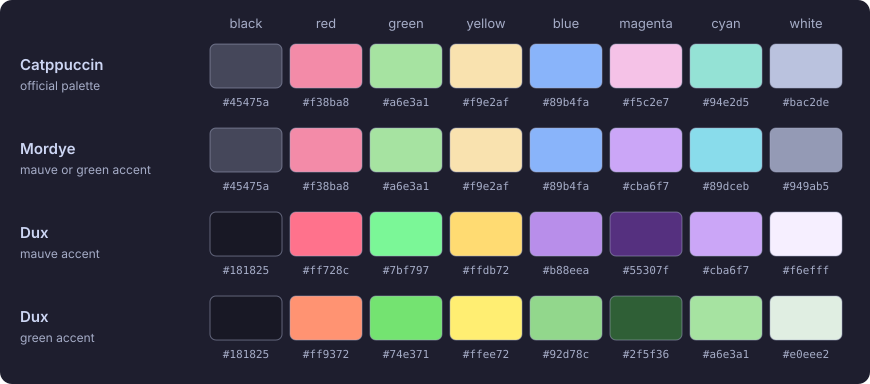
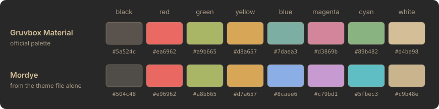

#  Mordye

[](https://github.com/robwilkerson/mordye/actions/workflows/ci.yml)

Mordye completes a theme's palette without bending it. Every color the theme defines comes through untouched, and every gap is filled in the theme's own style. You get every interface role an app needs, plus all 16 terminal colors.

Desktop shells and theme tools describe palettes in Material roles (`primary`, `surface`, `error`, and so on), and most themes fill in only some of them. Terminals need 16 distinct colors, and few themes define them all. Tools that fill the gaps usually shift every hue toward the accent, so "blue" and "cyan" turn into shades of your accent color.

How Mordye stays true to the theme:

- **A color the theme defines is used as-is.** Its red is your red, and its yellow is your yellow.
- **A missing color is generated at its usual hue**, at the palette's own chroma and lightness, so a muted theme gets a muted green and a pastel theme a pastel one.
- **The accent shows where it belongs.** Changing it moves `primary`, `secondary`, and `tertiary`, the text on `primary` (`on_primary`) when the theme doesn't set one, and the terminal cursor. The 16 terminal colors never move, so red still means red in `git diff` and blue is still a directory in `ls`.

## How It Works

Every color in the output comes from the first source on its row that has one. Mordye only reaches further down a row when the theme leaves a gap.

| Color | Where It Comes From, in Order |
|---|---|
| `primary`, `secondary`, `tertiary` | The accent you chose, on a theme with an accent menu. Then the theme's own role. A missing `secondary` copies `primary`, and `tertiary` copies `secondary`. |
| `error`, `warning`, `info` | The theme's own role. Then the terminal red, yellow, or blue, which may be one of the theme's swatches. |
| Other interface roles | The theme's own role. Then a rule built from the theme's other colors ([Surfaces](#surfaces), [Interface Roles](#interface-roles)). |
| The 16 terminal colors | The theme's [terminal palette](#terminal-colors), bundled with Mordye or given in the input. Then a theme color matched to the slot by hue. Then a color generated at the slot's usual hue. Black, white, and the brights follow their own rules. |
| Terminal cursor | The accent you chose. Then the terminal palette. Then the foreground. |
| Terminal background, foreground, and selection | The terminal palette. Then the matching interface role. |

The accent never reaches the 16 terminal colors, so red still means red in `git diff`, and blue is still a directory in `ls`.

### Why Am I Seeing This Color?

Look the field up in the output's `sources` map. Each value names where its color came from:

- **`colors.<role>`:** the theme defined it.
- **`swatches.<name>`:** one of the theme's extra colors, such as Catppuccin's `mauve`.
- **`palette.<id>`:** the theme's bundled terminal palette, such as `palette.dracula`.
- **`terminal`:** terminal colors given in the input.
- **`ui.<role>`:** copied from an interface role.
- **`generated`:** the theme had nothing usable, so Mordye made it.
- **A note, such as `bright.white, dimmer`:** derived from another field.

For example, Catppuccin Mocha with the green accent and no terminal palette:

```json
"ui.primary": "colors.primary",
"ui.tertiary": "ui.secondary",
"terminal.normal.red": "colors.error",
"terminal.normal.magenta": "swatches.mauve",
"terminal.normal.white": "bright.white, dimmer",
"terminal.cursor": "ui.primary"
```

Primary is the theme's own (the green accent), and tertiary copies secondary. Red is the theme's `error` color, and magenta is Catppuccin's mauve. White is a dimmer bright white, and the cursor shows the accent.

## How It Compares

Each image shows a theme's eight normal terminal colors next to its official palette, one for each way Mordye gets them: from a [bundled palette](#bundled-palettes), and by falling back to the theme file alone.



**Catppuccin Mocha, with its bundled palette.** Mordye's terminal is the official one, all eight colors, whichever accent you pick. [Dux Shell](https://github.com/duxlabs-dev/dux-shell)'s own terminal follows the accent, as Material You intends: with green, its blue, magenta, and cyan all become greens.

Dux is here because it's the shell I use, and the comparison is a fair one rather than a knock on it. Building terminal colors from the accent is the Material You approach, and Dux follows it as designed; many shells and theme tools do the same. Mordye is for when you want the theme's own colors instead.



**Gruvbox Material, from the theme file alone.** It has no bundled palette yet, so Mordye matches by hue. Red, green, and yellow are the theme's own colors, a step from the official ones because Dux's theme file has them slightly differently. Blue, magenta, and cyan are generated at each slot's usual hue, at Gruvbox's own lightness and chroma, but Gruvbox's official ones sit elsewhere: its blue is teal, and its cyan is green.

Dux's rows are the palettes it generated on 2026-11-15. `bin/readme-swatches.sh` redraws both images, running Mordye for its rows.

## Install

Each [release](https://github.com/robwilkerson/mordye/releases/latest) has Linux builds for x86_64 (`amd64`) and ARM (`arm64`), as a tarball or an RPM. This installs the latest release; set `ARCH=arm64` on ARM, or `VERSION` to pin a release:

```bash
ARCH=amd64
VERSION=$(curl -fsSLo /dev/null -w '%{url_effective}' https://github.com/robwilkerson/mordye/releases/latest)
VERSION=${VERSION##*/v}
curl -LO "https://github.com/robwilkerson/mordye/releases/download/v${VERSION}/mordye_${VERSION}_linux_${ARCH}.tar.gz"
tar -xzf "mordye_${VERSION}_linux_${ARCH}.tar.gz" mordye
install -m 755 mordye ~/.local/bin/

# or, on Fedora and other RPM systems:
sudo dnf install "https://github.com/robwilkerson/mordye/releases/download/v${VERSION}/mordye_${VERSION}_linux_${ARCH}.rpm"
```

Each release's `checksums.txt` lists the SHA-256 of every file, to check a download with `sha256sum --check --ignore-missing checksums.txt`.

On another platform, or to build from source, use Go 1.27 or later:

```bash
go install github.com/robwilkerson/mordye/cmd/mordye@latest
```

Check that it worked:

```bash
mordye --version
echo '{"version":1,"colors":{"primary":"#c6a0f6","on_surface":"#cad3f5"}}' | mordye
```

The first prints `mordye` and its version. The second prints a complete palette as JSON.

## How It Fits Together

```
source files ──► adapter ──► generator ──► complete palette ──► your app templates
```

- **Adapters** translate one source's theme format for the generator. They are built in, so Mordye is one binary with no dependencies.
- **The generator** fills the gaps. It knows nothing about any particular source.
- **Your templates** read the complete palette, which always has the same fields.

Mordye reads only the files you name on its command line. Finding them, such as where a source keeps its settings, is the caller's job:

```bash
mordye dux --settings ~/.config/dms/settings.json \
  --theme ~/.config/dms/themes/catppuccin/theme.json > palette.json
```

| Source | Files It Takes |
|---|---|
| `dux` ([Dux Shell](https://github.com/duxlabs-dev/dux-shell), formerly DankMaterialShell) | The theme file; optionally, the settings for the flavor and accent you chose |

A source with no built-in adapter can write the input format below and pipe it in: `mordye < input.json`.

## Input and Output

The input is a sparse palette:

- **`colors`:** any subset of the known roles. Only `primary` and `on_surface` are required.
- **`swatches`:** extra theme colors with no role, such as Catppuccin's accent menu. They can fill terminal slots. The only interface roles one can reach are a missing `error`, `warning`, or `info`, by way of the terminal red, yellow, or blue (see [Interface Roles](#interface-roles)).
- **`accent`:** on a theme with an accent menu, the swatch you chose. It keeps `primary` and `secondary` out of the terminal colors, so changing the accent never moves them.
- **`terminal`:** any terminal colors the source already has. These pass through unchanged, except that a chosen `accent` keeps the cursor.
- **`palette`:** the id of a [bundled terminal palette](#bundled-palettes), such as `dracula`. It fills `terminal` when the input has no terminal colors of its own. When it has some, those win whole, so two palettes never mix. An id Mordye doesn't bundle is an error. Built-in adapters set it for the themes they know.

The palette's `name` and every swatch name must start with an ASCII letter or digit, then use only letters, digits, `.`, `_`, and `-`. Names come from theme files and end up in generated config, so Mordye rejects anything else rather than pass it along.

Input colors may use either case. Every output color is lowercase `#rrggbb`, including the ones that pass through, so you can compare colors as strings.

The output always has the same 37 fields:

- **15 interface roles**, such as `primary`, `background`, `surface_container_high`, and `on_surface`
- **22 terminal fields**: background, foreground, cursor, cursor text, selection, and the 16 normal and bright colors

A `sources` map records where each field came from: passed through, taken from a bundled palette, a role, or a swatch, or generated.

The palette goes to stdout and errors to stderr. A failure never writes a partial palette, and the exit status says what went wrong:

| Exit | Meaning |
|---|---|
| 0 | Success. `mordye --help` and `mordye dux --help` exit 0 too. |
| 1 | Bad input, such as a file Mordye can't read or a theme it can't complete. |
| 2 | A mistake in the command: an unknown source or flag, or a missing required one. |

## How Mordye Fills the Gaps

Every color Mordye adds comes from a rule that reads the theme's own colors. These rules matter most for the interface roles, where themes leave real gaps and there's no official answer to copy. For the terminal, a theme's own terminal palette beats any rule.

This section says what each rule reads and why; the exact math lives in [`palette.go`](palette.go). If a result looks wrong, you can point at the rule or the input behind it, not just the color.

The math happens in [OKLCH](https://bottosson.github.io/posts/oklab/), which separates lightness, chroma (how tinted a color is), and hue, and where equal steps look equal.

### Surfaces

`surface_container`, `surface_container_high`, and `surface_container_highest` form a ladder, each a step beyond the one below (lighter, in a dark theme). A missing rung is built from the rungs the theme defines:

- **Tint:** it takes the hue and chroma of the nearest defined rung, so a slate theme stays slate.
- **Lightness:** it sits the theme's own spacing away, in the theme's own direction: the average gap between the rungs the theme defines.

A theme that defines one rung gives no spacing to copy, so Mordye uses Catppuccin Macchiato's. A theme that defines none gets the whole ladder generated, along with any missing `background`, `surface`, or `outline`, as near-grays at fixed lightness with a hint of the theme's outline (or text) tint.

**Example: Nord** defines `surface_container` (`#434c5e`) and `surface_container_high` (`#4c566a`), 0.037 apart in lightness. Mordye puts `surface_container_highest` one more step up, in the same slate: `#566075`.

### Terminal Colors

**A theme's own terminal palette beats any rule.** Most themes publish an official terminal port, the canonical terminal palette as the theme's authors define it, with a color for all 16 slots. Mordye bundles those ports for well-known themes (see [Bundled Palettes](#bundled-palettes)), and the built-in adapters use them with no extra step. Its colors, plus cursor and selection, pass through unchanged. The one exception is the cursor on a theme with an accent menu: it shows the accent you chose, over the palette's.

A source with its own terminal colors can pass them in the input's `terminal` instead. They win over a bundled palette, whole.

**Without one, Mordye falls back to matching by hue.** It keeps every color the theme defines, but it has to guess which slot each one fills and generate the rest, so the result won't equal the official palette. Themes that fill slots by name come out differently: Dracula's blue slot holds its purple, and Rosé Pine's green holds its pine.

#### Bundled Palettes

Each bundled palette is a theme's official terminal port, made by the theme's own authors, under a license compatible with Mordye's MIT. Mordye stores them in one format and reads nothing else at runtime. A tool in the repository converts each upstream port at a pinned commit, and CI rebuilds every palette to prove the bundled copy is unchanged. [ADR 0002](docs/decisions/0002-bundled-terminal-palettes.md) has the reasoning.

| Theme | Palette ids | Official port | License |
|---|---|---|---|
| [Catppuccin](https://catppuccin.com) | `catppuccin-mocha`, `catppuccin-macchiato`, `catppuccin-frappe`, `catppuccin-latte` | [catppuccin/kitty](https://github.com/catppuccin/kitty) | MIT |
| [Dracula](https://draculatheme.com) | `dracula` | [dracula/kitty](https://github.com/dracula/kitty) | MIT |
| [Flexoki](https://stephango.com/flexoki) | `flexoki-dark`, `flexoki-light` | [kepano/flexoki](https://github.com/kepano/flexoki) | MIT |
| [Kanagawa](https://github.com/rebelot/kanagawa.nvim) | `kanagawa`, `kanagawa-dragon`, `kanagawa-light` | [rebelot/kanagawa.nvim](https://github.com/rebelot/kanagawa.nvim) | MIT |
| [Nord](https://www.nordtheme.com) | `nord` | [nordtheme/xresources](https://github.com/nordtheme/xresources) | MIT |
| [Rosé Pine](https://rosepinetheme.com) | `rose-pine`, `rose-pine-moon`, `rose-pine-dawn` | [rose-pine/kitty](https://github.com/rose-pine/kitty) | MIT |
| [Solarized Osaka](https://github.com/craftzdog/solarized-osaka.nvim) | `solarized-osaka-dark`, `solarized-osaka-light` | [craftzdog/solarized-osaka.nvim](https://github.com/craftzdog/solarized-osaka.nvim) | Apache-2.0 |
| [Tokyo Night](https://github.com/folke/tokyonight.nvim) | `tokyonight-night`, `tokyonight-storm`, `tokyonight-moon`, `tokyonight-day` | [folke/tokyonight.nvim](https://github.com/folke/tokyonight.nvim) | Apache-2.0 |

Light palettes are bundled for when Mordye completes light themes ([#27](https://github.com/robwilkerson/mordye/issues/27)). Each palette file records the exact commit it came from, and each release ships the upstream license notices beside the binary. To add a theme's palette, see [CONTRIBUTING.md](CONTRIBUTING.md#adding-a-terminal-palette).

Without a port, each chromatic slot has a usual hue: red, yellow, green, cyan, blue, and magenta. A theme color fills a slot when its hue is within 30° of the slot's, and it can fill only its nearest slot. Near-grays never fill one.

- **Ties:** a named role (such as `error`) beats a swatch, and then the closer hue wins.
- **Status colors:** `error` and `warning` claim red and yellow first, when their hue is in range.
- **Accent:** on a theme with an accent menu, `primary` and `secondary` are left out, so changing the accent never moves a terminal color.

A slot no theme color fills is generated at its usual hue, at the palette's typical lightness and a little under its typical chroma. Typical means the median across the theme's colors, so a muted theme gets a muted green and a pastel theme a pastel one.

Black is the highest surface rung the theme itself defines, and bright black is a step lighter. Bright white is the theme's least-tinted text color that is at least as light as the terminal foreground, and white is a step dimmer.

When the input supplies its own bright white, white steps from it. When it supplies its own black, bright black still steps from the surface rung, and `sources` names that rung. Programs draw dim text, such as comments and shell suggestions, in bright black on the background. A step from a pure-black black would make that text invisible, and themes with a pure-black black pair it with a mid gray.

**Example: Dracula's** theme file defines no green. Without its port, Mordye generates one at green's usual hue, as light as Dracula's other colors and nearly as saturated: `#86c279`.

### Interface Roles

- `secondary` falls back to `primary`, and `tertiary` to `secondary`.
- `error`, `warning`, and `info` fall back to the terminal red, yellow, and blue. Those may hold a swatch, since the theme's own red beats a generated one.
- `on_primary` is `background` or `on_surface`, whichever contrasts more with `primary`.
- `on_surface_variant` is `on_surface`, a step dimmer.

Any non-ANSI terminal field a port doesn't set comes from the interface roles: the background from `background`, the foreground from `on_surface`, and the selection from `surface_container_high`. The cursor is chrome, so on a theme with an accent menu it takes `primary`, the accent you chose. On other themes it matches the foreground, as most official ports draw it.

### Fixed Numbers

A few rules need a number no theme supplies. They were tuned against the seven themes below, and they're the first place to look when a result seems off:

- **30°:** how far a theme color's hue may sit from a slot's and still fill it.
- **0.04 chroma:** below this, a color counts as a near-gray and fills no slot. Text colors need 0.08, since most are faintly tinted.
- **0.1 chroma** for generated colors when a theme has no tinted colors at all, at its text's lightness.
- **80%:** the share of the palette's typical chroma a generated color takes, so it sits behind the theme's own.
- **+0.05 lightness** for a generated yellow, which reads darker than other hues at the same lightness.
- **0.06 lightness:** the step from black to bright black, and from bright white to white.
- **0.1 lightness:** how much dimmer `on_surface_variant` is than `on_surface`.
- **25%:** the share of the outline's chroma a generated gray keeps.
- **0.07 lightness:** the spacing between surface rungs when a theme defines only one.
- **Catppuccin Macchiato's lightness** for each surface, when a theme defines none.

## Status

Early development. The color rules were prototyped against seven themes: Catppuccin Macchiato and Mocha, Tokyo Night, Nord, Gruvbox Material, Dracula, and Rosé Pine.

## Known Limitations

- **Dark themes only.** Mordye completes a theme's dark variant, and its tuning assumes a dark background. Light themes are [#27](https://github.com/robwilkerson/mordye/issues/27).
- **One built-in source.** Dux Shell is the only theme adapter so far. Any other source has to write Mordye's input format itself.
- **Some themes have no bundled palette.** A theme without a qualifying official port gets hue-matched terminal colors. Everforest, Gruvbox, and Gruvbox Material are next ([#40](https://github.com/robwilkerson/mordye/issues/40)).
- **The format may still change.** How the input and output formats evolve, and what `sources` values look like, aren't settled yet ([#13](https://github.com/robwilkerson/mordye/issues/13), [#14](https://github.com/robwilkerson/mordye/issues/14)). Pin a version.
- **Linux builds only.** Releases ship Linux binaries; other platforms build from source with `go install`.

## Credits

The test fixtures in `adapter/dux/testdata/` are theme files from the [Dux plugin registry](https://github.com/duxlabs-dev/dux-plugin-registry), copied unchanged so the adapter is tested against real themes. They are the work of their authors, and the palettes they carry belong to their own projects: [Catppuccin](https://catppuccin.com), [Dracula](https://draculatheme.com), [Gruvbox Material](https://github.com/sainnhe/gruvbox-material), [Nord](https://www.nordtheme.com), [Rosé Pine](https://rosepinetheme.com), and [Tokyo Night](https://github.com/folke/tokyonight.nvim).

The fixtures in `converters/testdata/` are official terminal ports, also copied unchanged and MIT licensed: [Catppuccin's](https://github.com/catppuccin/kitty), [Dracula's](https://github.com/dracula/kitty), and [Rosé Pine's](https://github.com/rose-pine/kitty) kitty ports, and [Nord's](https://github.com/nordtheme/xresources) Xresources port.

The [bundled palettes](#bundled-palettes) carry the colors of each theme's official port and belong to their own projects. Each keeps its upstream license, whose text is in `palettes/notices/`.

## About the Robot

Yes, an LLM helped write this. So did an editor, a compiler, a linter,
autocomplete, and a number of other tools. It's just a tool. One that "talks"
back, but still a tool. And it helps me salvage some of my weekend. It types
faster than I do, reads faster than I do, and, much to my chagrin, knows more
than I do.

Every line here was read, discussed, sometimes argued, and ultimately signed
off by a human (me). I theme my own desktop with it every day and live with the
result.

The AI doesn't get the credit and it doesn't get the blame. If something here
is broken, sloppy, or wrong, that's 100% on me and I welcome the feedback. A
bug report or a PR is always appreciated.

## License

[MIT](LICENSE). The test fixtures and bundled palettes are credited above and are not covered by it.

## The Name

A mordant is what dyers use to fix color into fabric. It binds the dye so the colors hold and sit together evenly. Mordye is mordant plus dye, and it reads as "more dye," which is the job: adding the colors a palette is missing, and making them hold together with the ones already there.
